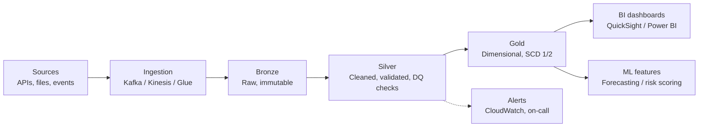

# Harish Reddy Singi Reddy

> I build data pipelines that business teams can trust: governed, quality-checked, and tied to a clear outcome.

<b>About me</b>

 

Senior Data Engineer with 7+ years building production data pipelines, lakehouses, and analytics platforms.

- End-to-end ownership: ingestion, transformation, orchestration, quality checks, and the analytics layer on top
- I care about the boring parts that make data usable: contracts, tests, monitoring, and on-call ownership
- I mentor junior data engineers and I like turning messy, real-world data into something a team can decide on

<b>What I do best</b>

 

| Area | What that means in practice |
|---|---|
| Lakehouses | Hive to Apache Iceberg migrations, snapshot time travel, Spark at petabyte scale |
| Pipelines | PySpark, Airflow, AWS Glue, EMR, Lambda, S3, Athena, Kafka, Kinesis |
| Modelling | Dimensional modelling, SCD Type 1/2, dbt, Trino, governed gold layers |
| ML on data | Demand forecasting, fraud and risk scoring, BERT classification for customer topics |
| Platform | Terraform, Docker, GitHub Actions CI/CD, CloudWatch, data quality frameworks |

## 📊 GitHub stats

## 🛠️ Stack at a glance

## 🧭 How a pipeline I build looks

## 📈 Activity

<b>🔍 Project deep dives, click to open</b>

 

- **AWS pipeline starter kit:** Glue job, Lambda validator, Athena queries, Terraform for the whole stack, data quality checks before anything lands in gold.
- **Iceberg lakehouse:** Hive tables migrated to Iceberg, snapshot time travel to roll back a bad load, Airflow orchestrating the migration in stages.
- **Demand forecasting:** lag and rolling features, seasonal patterns, backtest on the last 90 days with no leakage, plain-English driver summary per product.
- **Credit fraud risk:** feature store style inputs, a transparent scoring model, and a score entry point you can run on a single record.
- **People analytics:** lifecycle data into governed layers, row and column level access controls, attrition and headcount reporting.
- **Incentive analytics:** heavy Snowflake transformations, tiering by historic patterns, dashboard-ready gold table.

<b>💬 Ask me about</b>

 

- Lakehouse migrations, Hive to Iceberg, and when not to migrate
- Data quality that actually catches bad loads before dashboards do
- Dimensional modelling, SCD Type 1/2, and gold layer design
- PySpark performance tuning and Airflow orchestration
- Demand forecasting and fraud scoring on real, messy data

## Featured projects

Click a project to explore it. Every repo runs locally with synthetic data, no setup beyond Python.

| Project | Try it | What it demonstrates |
|---|---|---|
| [aws-data-pipeline-starter-kit](https://github.com/harishsingi/aws-data-pipeline-starter-kit) | `make demo` | Production-grade AWS pipeline: Glue, EMR, Lambda, S3, Athena, Terraform, Docker, data quality |
| [hive-to-iceberg-lakehouse](https://github.com/harishsingi/hive-to-iceberg-lakehouse) | `python -m src.migrate` | Lakehouse migration, snapshot time travel, Spark, Airflow orchestration |
| [demand-forecasting-ml](https://github.com/harishsingi/demand-forecasting-ml) | `python -m src.score` | ML demand forecasting: feature engineering, backtesting, plain-English driver summary |
| [credit-fraud-risk-model](https://github.com/harishsingi/credit-fraud-risk-model) | `python -m src.score` | Fraud and risk scoring for credit eligibility decisions |
| [people-analytics-warehouse](https://github.com/harishsingi/people-analytics-warehouse) | `python -m src.build` | Governed HR warehouse: lifecycle data, SCD 1/2, attrition and headcount reporting, access controls |
| [incentive-analytics-snowflake](https://github.com/harishsingi/incentive-analytics-snowflake) | `python -m src.build_gold` | Snowflake-style transformations for incentive dashboards, invoice and cost reporting |

> These repos are clean-room portfolio recreations of production work. All data is synthetic, and no proprietary code, data, schema names, or internal system details from any employer are included.

<b>Core stack</b>

 

- **Languages:** Python, SQL, PySpark, C
- **AWS:** Glue, EMR, Lambda, S3, Athena, CloudWatch, Step Functions
- **Data platform:** Apache Iceberg, Apache Spark, Airflow, Databricks, Snowflake, dbt, Trino, Kafka, Kinesis
- **Engineering:** Terraform, Docker, GitHub Actions CI/CD, Git, data quality frameworks, dimensional modelling (SCD Type 1/2)
- **BI and ML:** QuickSight, Power BI, demand forecasting, fraud and risk models, BERT classification

<b>Education</b>

 

- MS, Business Analytics, concentration in Data Engineering and Infrastructure
- Bachelor's, Computer Science

## Get in touch

- Email: sharishreddy.2023@gmail.com
- Open to relocate anywhere in the USA
- 🌱 Currently exploring: streaming ingestion, data observability, and agentic data infrastructure
